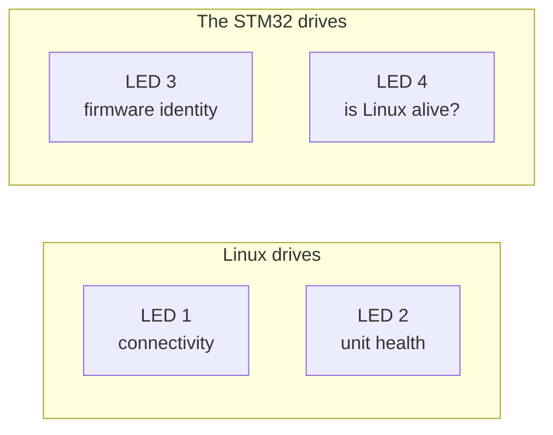

<!--
Copyright (c) 2026 Jim Wyatt
SPDX-License-Identifier: MIT
-->
# Four lights that tell the truth

There are four RGB LEDs on this board, in a row at the end of the board opposite the USB-C port, where the long
header ends. From the board's edge inwards they are LED 4, LED 3, LED 2 and
LED 1. Out of the factory they do almost nothing useful. This chapter is about
turning them into instruments — and it is really a chapter about **designing an
indicator**, which is a harder problem than it sounds and one you will meet
again on anything that has to report on itself.

The rule everything below follows:

> [!IMPORTANT]
> An indicator earns its place only if a **change in it** carries information
> you did not already have. Anything else is decoration that costs you attention
> every time you glance at the board.

## Counting them is the first surprise

Ask Linux what LEDs it has:

```bash
ls /sys/class/leds/
```

```
mmc0::            unoq:bt-blue2     unoq:panic-red2
unoq:user-blue1   unoq:user-green1  unoq:user-red1
unoq:wlan-green2
```

Seven entries. This project's first attempt read that as seven indicators, lit
them independently, and produced a board showing two solid blue lights and no
information whatsoever.

They are not seven LEDs. They are **two RGB packages** — three colour channels
each — plus one kernel entry (`mmc0::`) for a light that is not on this board at
all. `user-red1`, `user-green1` and `user-blue1` are the red, green and blue
elements of a single physical LED. Drive all three and you get white, which is
why the board looked wrong.

That leaves two more physical LEDs, and they are not Linux's. They belong to the
STM32, which sees them as `led3_red`/`led3_green`/`led3_blue` and `led4_*`.



## Choosing what each one says

Four indicators, and far more than four things you could show. The interesting
part is what got rejected.

### LED 1 — can this board reach anything?

| | | |
|---|---|---|
| **steady** | green | the internet is reachable |
| **slow blink** | blue | a computer is on the USB cable, but nothing beyond it |
| **fast blink** | red | no uplink at all |

Each state has a rhythm as well as a colour. Take the rhythm on trust for now;
[why it is there](#colour-alone-was-not-enough) comes after the design it
rescued.

Blue is the one that earns its keep. "Cable plugged in but the host is not
sharing its connection" and "nothing there at all" are completely different
problems with completely different fixes, and without a third colour they look
identical.

### LED 2 — does anything need a human?

| | | |
|---|---|---|
| **steady** | green | every systemd unit is healthy, and the bind guard has not tripped |
| **fast blink** | red | something has failed that will **not** recover on its own |

Note how narrow that is. Almost everything on this board retries: the USB link
comes back, the gadget rebinds, wifi falls back. Those are not worth a light.
Red means the self-healing has been exhausted.

### Green is not decoration

A dark LED cannot distinguish "nothing is wrong" from "the thing that checks
whether anything is wrong is not running". Those need very different responses,
so healthy is a *colour*, not an absence: a lit, steady light. The service that
drives these has `Restart=always` and an `ExecStopPost` that turns them off —
so if the checker dies, the board goes dark rather than staying confidently
green.

## The two that got thrown away

The first design for LEDs 3 and 4 was the obvious one: blink on MPU↔MCU traffic,
and light up on eMMC activity. Both were wrong, and the board made it obvious
within a minute of looking at it.

**"Blink on every message" made LED 3 into a clock.** The CPU-bars demo sends a
frame every 0.5 seconds, so the light blinked every 0.5 seconds, forever. An
indicator whose period is set by somebody else's timer tells you the timer is
running. The matrix beside it already said that, in more detail.

**eMMC activity could not be shown at a useful resolution.** Linux samples the
disk counters twice a second and would have to push the answer down a 115200
serial line. A real activity light flickers on individual transfers; what this
produced was a lamp that sat on for the duration of a copy and off otherwise —
which the CPU bars already implied.

There is a second, sharper reason it failed. The kernel offers `mmc0`,
`disk-activity` and `disk-write` triggers on this board, and **none of them
fire**: measured at 0 of 400 samples under sustained writes. An indicator wired
to a trigger that never fires is worse than no indicator, because a dark light
reads as "idle".

## What replaced them

Both were re-pointed at things **only the microcontroller knows**, and that
change slowly enough that every transition means something.

### LED 3 — the firmware's own identity

| | | |
|---|---|---|
| **steady** | green | running a **confirmed** image — this is what survives a reset |
| **slow blink** | yellow | running an **unconfirmed** image, on MCUboot probation |
| **fast blink** | red | a subsystem failed to start |

Yellow is the good one. After a firmware update, MCUboot runs the new image on
trial; if nothing confirms it, the next reset reverts to the old one. That state
is completely invisible unless you go and read the slot table — and it is
precisely what you want to see on the hardware after an update, because it is
the difference between "the update took" and "the update is about to undo
itself". See [Updating safely](updating-safely.md).

### LED 4 — is the other chip still there?

| | | |
|---|---|---|
| **steady** | green | heard from Linux within the last four seconds |
| **fast blink** | red | silence for longer than that |

This is the inverse of the blink it replaced, and the inversion is the whole
point. A tick tells you nothing. **The tick stopping is the news** — and it is
news Linux structurally cannot deliver, because a host that has stopped talking
cannot report that it has stopped talking.

It is the only indicator on the board that says something about the *other*
chip's health, and it is on the correct chip to say it.

> [!NOTE]
> "Heard from Linux" means one of the firmware's own `app` commands arrived:
> `app status`, `app bars`, or an `app matrix` command. Nothing else counts.
> On a board set up for this course the thing sending them is
> `unoq-cpu-bars.service`, which draws twice a second. So LED 4 is steady green
> while that service runs and blinking red a few seconds after it stops, and it
> starts out blinking red at every MCU reset until the first command arrives.

## Colour alone was not enough

Everything above was first built with colour as the only channel, and mostly
with one pair of colours: red against green. That is the one pair that roughly
one man in twelve cannot reliably tell apart. To them LED 2 and LED 4 each had
a single state, and LED 3's green, yellow and red were three shades of much the
same thing. The board said "everything is fine" and "this needs a human" with
the same light.

The mistake is worth looking at, because it came straight out of an argument
that was right. Healthy has to be a colour rather than an unlit LED — so every
state became a colour — so colour was carrying *all* of the information, and
nobody had asked whether it could be read. A great deal of care went into what
the lights say and none into whether they can be seen saying it.

The fix is a second channel that does not pass through colour at all: time.

| | means | looks like |
|---|---|---|
| **steady** | fine | lit, and not changing |
| **slow blink** | degraded, or in progress | once every two seconds |
| **fast blink** | a fault that needs a human | twice a second |
| **dark** | nothing is driving this LED | the checker is not running |

Colour still says what it said. But no LED uses one rhythm for two states, so
the rhythm identifies the state by itself, and colour has become the second
witness instead of the only one. It cost a timer, not a wire.

Three things about it are deliberate.

**Dark keeps its meaning.** A blink is half darkness, and darkness already
means "the checker is not running". So steady states never go dark, even for a
moment, and both blinks are quick enough that nobody waits long for the light
to come back. When the service stops, its `ExecStopPost` cancels the blink as
well as the light. That matters more than it did: the kernel does the blinking,
with no process behind it, so a blink left running would look more alive than
a steady light ever did.

**Nothing in the loop blinks.** `leds.sh` wakes every five seconds; it cannot
blink anything twice a second. It hands the channel to the kernel's
`timer` trigger with an on-time and an off-time and leaves it alone — and it
has to leave it alone, because every write to those files restarts the blink.
A script that rewrote the same state on every pass would produce a light that
hiccups every five seconds, which is a fourth rhythm that means nothing. So a
pass first reads back what the LED is doing, and writes only if that is not
what it should be doing. The firmware has it easier: it redraws both of its
LEDs four times a second from one counter, on the work item that was already
there for the once-a-second check.

**The channels of one LED blink as one.** Yellow is the red and the green
element lit together. Blink them separately and "yellow, slowly" becomes red
and green taking turns, which is worse than no blink. In the firmware one
decision — lit on this beat, or not — drives every channel of the LED.

This is not the blink that got thrown away. Blinking on every message was
rejected because its period belonged to somebody else's timer, so it told you
only that the timer was running. Here the rhythm is a property of the *state*,
exactly as the colour is, and it changes only when the state does. The rule at
the top of the page is intact: the news is still the change.

> [!NOTE]
> If a kernel offers no `timer` trigger, `leds.sh` shows the colour steady
> and says so, once, in its log. Half the information is better than a dark
> LED. Check what yours offers with
> `cat /sys/class/leds/unoq:user-red1/trigger`.

## A bug this design produced, and what it taught

The first version read the confirmed flag once, in `main()`, and cached it. So
after confirming an image by hand, LED 3 stayed yellow — reporting a state that
had been true at boot and was no longer true.

The fix is a one-second work item that re-reads `boot_is_img_confirmed()` while
the image is unconfirmed. The lesson generalises: **an indicator that samples
once is a memory, not an instrument.** Everything here re-samples — Linux every
five seconds, reachability every sixty, the MCU every one — so the lights
correct themselves instead of remembering something that stopped being true.

It is also why `leds.sh` reads the blink back from the kernel on every pass
rather than keeping a note of what it last set. A note is a memory too.

## Try it

What each light means, from the board itself:

```bash
~/two-computers-one-board/status/leds.sh explain
```

Learn them by watching them cycle:

```bash
sudo ~/two-computers-one-board/status/leds.sh test
```

Now make LED 2 tell the truth about a real failure. Break something on purpose.
Asking systemd to start a unit that does not exist is not enough: it prints an
error and leaves nothing behind, and LED 2 looks at the list of failed units.
So run a real, throwaway unit whose only job is to fail:

```bash
sudo systemd-run --unit=unoq-demo-fail /bin/false   # runs, exits 1, is marked failed
systemctl --failed                                  # unoq-demo-fail.service is listed
```

The LEDs are sampled every five seconds, so within about that long LED 2 should
start blinking red, fast. Clear it, and it goes back to steady green on the
next sample:

```bash
sudo systemctl reset-failed unoq-demo-fail
```

And prove LED 4 is watching Linux rather than blinking on a timer. Stop the one
thing that talks to the MCU, and watch:

```bash
sudo systemctl stop unoq-cpu-bars     # Linux goes quiet
```

LED 4 starts blinking red about five seconds later: four seconds of silence,
checked once a second. Then start talking again:

```bash
sudo systemctl start unoq-cpu-bars    # steady green within a second or two
```

Last, read the board the way one reader in twelve has to. Look at it through
your phone's camera with a black-and-white filter on, or simply from far enough
away that the colours wash out, and repeat the two experiments above. You
should be able to say which state each LED is in from its rhythm alone.

> [!TIP]
> **Go deeper** — [hardware.md](../reference/hardware.md) has the full
> LED table and which package each sysfs entry belongs to. The kernel's
> [LED class documentation](https://docs.kernel.org/leds/leds-class.html)
> explains what a *trigger* is and what those three inert ones were supposed to
> do. `status/leds.sh` and `mcu/app/src/status_leds.c` are both commented with the
> reasoning above.

## Check yourself

1. Seven entries in `/sys/class/leds/`, four physical LEDs. Explain.
2. Why is "healthy" a colour here rather than an unlit LED?
3. LED 4 is driven by the MCU and reports on Linux. Why can that not be done the
   other way round?
4. You want to add a fifth indicator for "the storage is nearly full". Argue
   both sides using the rule at the top of this page.
5. Blinking LED 3 on every message was thrown away as "a clock". Three of the
   four LEDs can now blink. Why is that not the same mistake?

<details markdown="1">
<summary>Answers — try each one first</summary>

1. **The entries are colour channels, not LEDs.** Six of the seven are the red,
   green and blue elements of two RGB packages, and `mmc0::` is a kernel entry
   for a light that is not on this board at all. That makes two physical LEDs
   for Linux; the other two belong to the STM32, which sees them as `led3_*`
   and `led4_*`.
2. **Because a dark LED is ambiguous.** It cannot distinguish "nothing is
   wrong" from "the thing that checks whether anything is wrong is not
   running". With a lit, steady light for healthy, and an `ExecStopPost` that
   turns the LEDs off and cancels any blink, a dead checker makes the board go
   dark rather than stay confidently green.
3. **Because the news is Linux going quiet, and Linux cannot report that.** A
   host that has stopped talking cannot report that it has stopped talking.
   Only the other chip can notice the silence, so the indicator has to be on
   the MCU.
4. **No single answer.** For: a change in it would carry information you did
   not already have, it changes slowly enough that every transition means
   something, and it may need a human. Against: you would have to say what
   "nearly" means, whether anything else already tells you, and whether it is
   worth a glance every time you look at the board. A good answer also makes
   it re-sample, makes "not full" a lit, steady light rather than an unlit
   LED, and gives "nearly full" a rhythm as well as a colour.
5. **Because the rhythm belongs to the state, not to the traffic.** The
   rejected blink happened once per message, so its period was somebody else's
   timer and it reported only that the timer was running. These blink at a
   fixed rate chosen by what is wrong, and the rate changes only when the state
   does — so a change in it still carries information. It is there so that the
   states can be told apart without telling red from green.

</details>

Next: [when none of the lights help, and you have to find out what a program
with no screen is actually doing](debugging-without-a-screen.md).
