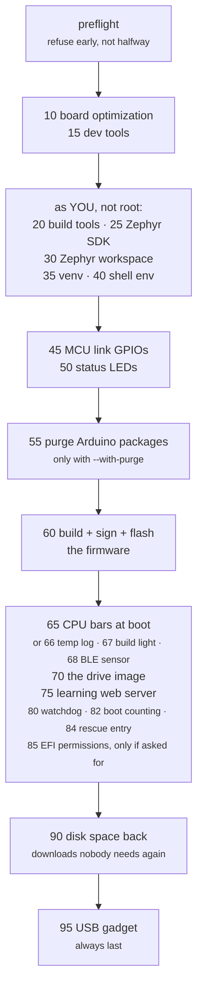

<!--
Copyright (c) 2026 Jim Wyatt
SPDX-License-Identifier: MIT
-->
# From factory to this

Every chapter so far has assumed a board that already works. This one is about
how it got that way, and it is the part of the project most worth copying,
because it is not really about this board at all.

The claim the whole repository stands on:

> [!IMPORTANT]
> A factory-reset UNO Q becomes the board described in this course by running
> **one command**, and running it a second time is safe.

That is a much stronger claim than "here are the steps", and everything about
how the scripts are written follows from trying to make it true.

> [!NOTE]
> **In this chapter**
>
> - why a script beats a list of steps, and why "the setup is the
>   specification" is stronger still
> - idempotence: what it means, what it buys, and the shape every step has
>   to take to get it
> - how the run is ordered, why half of it must not be root, and why the
>   costly parts are named before they happen
> - what happened when the claim above was actually tested
>
> **You need:** [The Linux side](the-linux-side.md) for systemd units, and
> [Set up a board](../setup.md), which is the page this chapter explains.
> The Try it reads a script and re-runs one small, safe step; it does not
> re-provision the board.

## Why not just write down the steps

Because instructions rot, and because you will need them at the worst possible
moment.

A list of commands in a README is untested by construction. It drifts from what
the board actually needs, one forgotten line at a time, and you only find out
when you are standing in front of a bricked board at midnight. A script that
runs is at least *executable* documentation — and if it is also run regularly,
it is documentation that cannot be wrong for long.

The stronger version is what this project aims at: the setup **is** the
specification. There is no separate description of how the board should be
configured, because the scripts are it.

## Idempotence, and why it is the whole design

The single most important property here:

**Running `bootstrap.sh` twice does the same thing as running it once.**

You have used idempotent commands already. `mkdir -p` is one: run it twice
and there is one directory. Plain `mkdir` is not: the second run is an error.
`x = 5` is idempotent; `x += 5` is not. The whole script is written to be
the first kind.

That is not a tidiness point. It changes what the script *is*:

- It becomes the recovery path. A run that died forty minutes in, halfway
  through a 2 GB download, is fixed by running it again — not by working out
  what got done and resuming by hand.
- It becomes safe to run on a board that is already working, which means people
  actually run it, which means it stays true.
- It becomes testable. You can run it on a board, then run it again and check
  that it reports "already done" for everything.

Achieving it is unglamorous. Every operation has to check first:

```bash
if systemctl is-enabled --quiet unoq-leds.service 2>/dev/null; then
  skip "status LEDs already enabled"
else
  systemctl enable --now unoq-leds.service
  did "status LEDs enabled and started"
fi
```

That shape is everywhere, which is why the shared primitives in
[`provision/lib.sh`](https://github.com/jim-wyatt/two-computers-one-board/blob/main/provision/lib.sh)
exist — `write_file`, `install_unit`, `disable_unit`, `apt_install`,
`ensure_group` — each of which is the idempotent version of something the shell
does not offer idempotently.

The output vocabulary matters too. Every script says one of four things about
every action. The `did` and `skip` in the snippet above are the names of the
functions that print them; what you see on the screen is the word in the first
column:

| Printed | Function | Meaning |
|---|---|---|
| `changed` | `did` | I changed something |
| `ok` | `skip` | already correct, I did nothing |
| `warn` | `warn` | something is not right, but I can continue |
| `FAILED` | `fail` | I cannot continue, and here is what to do |

Each script ends with a count, such as `0 changed, 9 already correct.` A second
run of one on a healthy board is a wall of `ok`. That is the signal you are
looking for, and it is only meaningful because the script genuinely checked.
(`bootstrap.sh` as a whole has one part that is not like this: the firmware is
built and flashed again on every run, and says `changed` each time.)

## The shape of the run



The purge has to be asked for, and it runs before the firmware is built
rather than with the others. The USB gadget is always last, because it takes
the USB host port down with it.
[Provisioning](../reference/provisioning.md) lists what each numbered step
changes.

Numbered, because order matters and a reader should be able to see it. Split at
`provision/user/`, because **half of it must not be root**: the Zephyr
workspace, the Python venv (a private Python installation for this project)
and the shell environment all belong to you, and a
`sudo` in the wrong place leaves a 2 GB directory you cannot write to. That is
a real failure mode, and the split is how it is prevented rather than warned
about.

## What costs you something is named before it happens

```bash
./bootstrap.sh                     # the whole board the course is taught on
./bootstrap.sh --no-cpu-bars       # ...without the LED matrix demo  (it holds /dev/ttyHS1)
./bootstrap.sh --no-learning       # ...without the web server on :8080
./bootstrap.sh --no-usb-gadget     # ...without IP over USB          (it takes the port from adb)
./bootstrap.sh --minimal           # ...without any of the three
./bootstrap.sh --with-purge        # and remove the Arduino packages
```

These three were opt-in once, on the principle that anything with a cost
should be asked for. The principle was sound and the result was not: a reader
following the course had to know to ask for the demo its exercises are built
on, and found the web server by wondering where it was. So the default became
the board the course assumes, and the principle moved to where it still
holds. Before it changes anything, the script prints what it is about to do,
with the cost of each of the three and the option that leaves it out, and
waits ten seconds.

Running the demo at boot claims the serial port, so the MCU shell stops working
until you stop the service. The USB gadget turns the only USB port into a
device, so nothing plugged into it works any more, and `adb` gives way to SSH.
What still has to be asked for is the purge, because it is hard to undo, and
the watchdog and the EFI lockdown, because each has been run on one board.

> [!NOTE]
> The web server serves the files on the drive image, so the image has to
> exist first — and `bootstrap.sh` builds it first. Unless both the web server
> and the USB gadget are left out, it runs `share/build-image.sh` as stage 70,
> ahead of both,
> with this documentation rendered onto it. It used not to, and a fresh board
> stopped at the web server's stage with `/srv/unoq-share has no content`. You will only see
> that message now if you run `provision/75-learning-web.sh` by hand on a
> board that has no image. The VS Code installers are not part of stage 70:
> they are a large, separate download, `sudo bash share/fetch-vscode.sh`.

This is a general principle worth taking away: **a setup script should not
quietly take something away from you.** If an option has a cost, the cost
belongs next to the option, in the interface, not three pages into a document.

## Every change says how to undo it

Near the top of each provisioning script:

```bash
# REVERT: systemctl disable --now unoq-usb-gadget.service &&
#         rm /etc/systemd/system/unoq-usb-gadget.service \
#            /etc/udev/rules.d/99-unoq-usb-gadget.rules &&
#         systemctl daemon-reload && udevadm control --reload
```

Writing that line is a discipline more than a feature. If you cannot state how
to undo a change in a couple of commands, the change is probably too broad, and
noticing that at the time it is written is much cheaper than noticing it later.

## The one file the scripts refuse to overwrite

`/etc/default/unoq-usb` is written once and then left alone, and the script says
why:

> It is the one file on this board a person is expected to edit, and a
> provisioning run that reset it every time would undo the change on the next
> bootstrap - most likely while the board is running on the very link the
> settings control.

That is the limit of "the script is the specification". Configuration a human
owns has to survive the tool, or the tool becomes something people stop running.

## What actually happened when this was tested

The claim at the top of this page was tested the honest way: by factory-resetting
a board and running the scripts on it. It did not work.

[The findings log](../reference/clean-board-findings.md) is the unedited record —
seventeen separate things wrong, each with the symptom, the cause and the fix
that went back into the scripts. A sample of the flavor:

- A `systemd` unit left behind in a failed state, so a board that was working
  reported as unhealthy forever.
- A preflight check that passed on a developed board and failed on a clean one,
  because it tested for something an earlier run had created.
- A tier of optimizations enabled by default that nothing in this project needs.

None of these are interesting individually. Collectively they are the point:
**"it works on my board" is not a claim about the board, it is a claim about
your board's history.** The only way to find out what you have accidentally
depended on is to start from nothing.

> [!NOTE]
> This is why [Knowing it works](knowing-it-works.md) is honest about CI running
> on a different architecture than the board. The same failure mode, one level
> up.

## Try it: read a script instead of running one

You almost certainly do not want to re-provision a working board right now. Read
one instead — they are written to be read:

```bash
less ~/two-computers-one-board/provision/95-usb-gadget.sh
```

Look for four things: the `REVERT:` line at the top, the `step` headings, an
`if` that checks before changing, and a comment explaining a decision rather
than restating the code.

Then see what a second run looks like on something small and safe:

```bash
sudo bash ~/two-computers-one-board/provision/45-mcu-link.sh
```

It should be almost entirely `ok`, and end with a line counting how many things
it changed and how many were already correct. That wall of "already correct" is
idempotence, working.

> [!TIP]
> **Go deeper** — [the findings log](../reference/clean-board-findings.md) is
> the full list. [ShellCheck](https://www.shellcheck.net/) is what keeps these
> scripts honest, and
> [systemd for Administrators](https://0pointer.de/blog/projects/systemd-for-admins-1.html)
> explains the unit behavior several of the findings turned on.

## Check yourself

1. What does idempotence buy you that a correct one-shot script does not?
2. Why is half of `bootstrap.sh` deliberately not run as root?
3. `/etc/default/unoq-usb` is written once and never again. Give the failure that
   rule prevents.
4. A colleague says their setup script "works, I ran it yesterday". What single
   question tells you whether that means anything?

<details markdown="1">
<summary>Answers — try each one first</summary>

1. **A script you can run again.** It becomes the recovery path — a run that
   died forty minutes in is fixed by running it again, not by working out what
   got done. It is safe on a board that already works, so people actually run
   it and it stays true. And it is testable: a second run should report
   "already done" for everything.
2. **Because half of what it makes belongs to you.** The Zephyr workspace, the
   Python venv and the shell environment are yours, and a `sudo` in the wrong
   place leaves a 2 GB directory you cannot write to. The split at
   `provision/user/` prevents that rather than warning about it.
3. **A bootstrap run undoing your own setting.** It is the one file a person is
   expected to edit. A run that reset it every time would undo the change on
   the next bootstrap — most likely while the board is running on the very
   link the settings control.
4. **"What did you run it on?"** — a clean, factory-reset board, or the one you
   have been developing on. "It works on my board" is a claim about your
   board's history; the only way to find out what you have accidentally
   depended on is to start from nothing.

</details>

## What to remember

- **Instructions rot; a script that runs is executable documentation**, and
  one that is run regularly cannot be wrong for long. Here the setup *is*
  the specification.
- **Idempotent**: running it twice does what running it once did. That makes
  it the recovery path, safe on a working board, and testable — a second run
  should be a wall of `ok`.
- Every step **checks before it changes**, says one of four words about
  every action (`changed`, `ok`, `warn`, `FAILED`), and carries a
  **`REVERT:`** line saying how to undo it.
- Steps are **numbered** because order matters, and **split at
  `provision/user/`** because half of the result must belong to you, not
  root.
- **Anything with a cost is named before it happens**, and the one file a
  person edits is never overwritten.
- **"It works on my board" is a claim about your board's history.** The only
  way to find out what you depend on is to start from nothing — which found
  seventeen bugs, five of which reported success.

Next: [what to build with all of this](make-it-yours.md).
