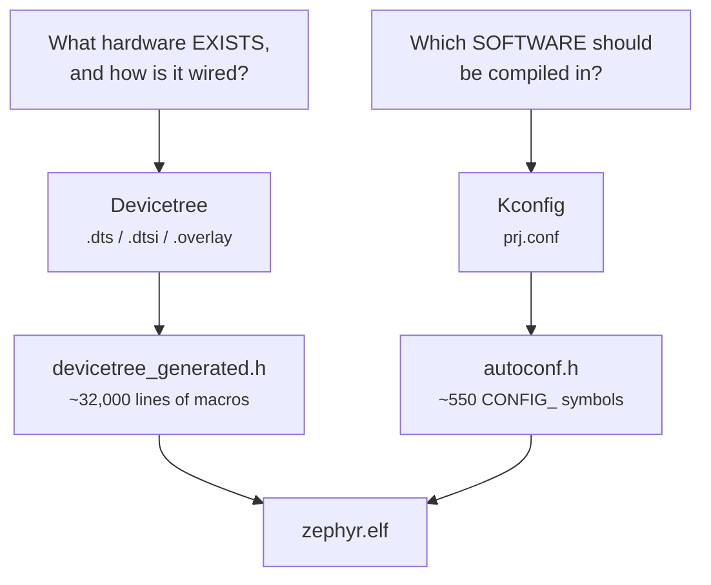

<!--
Copyright (c) 2026 Jim Wyatt
SPDX-License-Identifier: MIT
-->
# How the build knows your hardware

Zephyr supports something like a thousand boards. The source you just compiled
is the same source everyone else compiles. So how did it know that *this* board
has an LED panel wired across port F, that the console should come out of
`lpuart1` and not `usart1`, and that a timer called TIM17 exists at address
`0x40014800`?

Not by detecting any of it. A microcontroller cannot enumerate its own
circuit board. It was **told**, at build time, by two separate systems that
beginners constantly confuse with each other.

> [!NOTE]
> **In this chapter**
>
> - the two questions a build has to answer — what hardware exists, and
>   what software to compile — and the separate system that answers each
> - how to change what the board description says without editing the
>   board's file
> - why a feature you enabled can silently not be there
> - where to look to see what the build actually decided
>
> **You need:** [From source to a running chip](from-source-to-chip.md): the
> build directory it made is what you will read here. The Try it rebuilds
> the firmware but flashes nothing, so the demo can keep running.
>
> If you have used feature flags or `#ifdef`, Kconfig will feel familiar: it
> is compile-time flags with a dependency system. Devicetree has no everyday
> equivalent; it is closer to a configuration file describing the circuit
> board, turned into constants before the program is compiled.

## Two questions, two answers



**Devicetree describes hardware.** It is data, not code: a tree of nodes saying
"there is a UART here, at this address, with this interrupt, connected to these
pins". It cannot make anything happen. It is a description of a circuit board
that the build turns into C macros.

**Kconfig selects software.** It is a huge menu of yes/no choices: compile the
I²C driver or do not, include the shell or do not, build with MCUboot support or
do not.

The distinction that makes it click:

> [!IMPORTANT]
> Devicetree says the board **has** an I²C controller. Kconfig says your program
> **uses** one. Both must agree. `CONFIG_I2C=y` on a board whose devicetree has
> no I²C node compiles a driver that drives nothing; an I²C node with
> `CONFIG_I2C=n` describes hardware whose driver was never built.

Every "device not ready" error in Zephyr is, more often than not, those two
disagreeing.

## You do not edit the board file

Zephyr already ships a description of the UNO Q. Inside the Zephyr workspace,
`~/zephyrproject`, it is at `zephyr/boards/arduino/uno_q/arduino_uno_q.dts`. You
do not change it — it is
upstream's, it will be updated, and your board is not special enough to fork it.

Instead you write an **overlay**: a file that is layered on top. This
project's is
[`mcu/app/boards/arduino_uno_q.overlay`](https://github.com/jim-wyatt/two-computers-one-board/blob/main/mcu/app/boards/arduino_uno_q.overlay),
about two hundred lines of which two-thirds are comments, and it is worth
reading in full. The first three things it does are below. After them it
switches one converter back off (its comment says why), and then declares
what later chapters need: the SPI link, the three timers behind
[Jitter, measured](jitter-measured.md), and an I²C sensor.

### 1. Pick which device plays which role

```dts
/ {
	chosen {
		zephyr,console = &lpuart1;
		zephyr,shell-uart = &lpuart1;
	};
};
```

`chosen` is the devicetree's way of saying *which one*. The board has several
UARTs; this says the console goes out of `lpuart1`, which is the one physically
wired to the Linux side and appears there as `/dev/ttyHS1`. The Arduino header's
UART is `usart1`, and pointing the console at it is a mistake that produces a
board which looks completely silent while working perfectly.

### 2. Turn a device on

```dts
&gpiof {
	status = "okay";
};
```

Three words, and they matter more than they look. Devices in the SoC
description exist but are **disabled** by default — on one build of this
firmware, 72 of them were, against 32 enabled. A disabled node is not compiled into the image, gets no
driver instance, and its clock is never switched on.

`status = "okay"` enables port F, which is what makes its clock run. After that
[`matrix.c`](https://github.com/jim-wyatt/two-computers-one-board/blob/main/mcu/app/src/matrix.c)
writes the port's registers directly, because the 104 LEDs need pins that change
direction every 10 microseconds and the ordinary GPIO API is too slow for that.
See [The LED matrix](the-led-matrix.md).

### 3. Configure a device, and add a child

```dts
&timers17 {
	status = "okay";
	st,prescaler = <4>;

	counter_matrix: counter {
		status = "okay";
	};
};
```

`&timers17` reaches into an existing node and overrides part of it. A
**prescaler** is a divider in front of a timer, which makes it count more slowly
than the clock feeding it; a value of 4 here divides that clock by 5.
`st,prescaler` is a **binding-defined property**: the `st,stm32-timers` binding says a timer may
have one, and what it means. The `counter_matrix:` label is a name your C code
can use — `DEVICE_DT_GET(DT_NODELABEL(counter_matrix))` — to get a handle on
exactly this device and no other.

## What Kconfig adds

The overlay declares a counter. That does nothing on its own; the counter
*driver* still has to be compiled, and that is
[`prj.conf`](https://github.com/jim-wyatt/two-computers-one-board/blob/main/mcu/app/prj.conf)'s
job:

```kconfig
CONFIG_COUNTER=y
```

About fifty lines like that produce about 550 symbols in the final
configuration; both numbers move as the code does. The gap between them is
Kconfig's other half: **dependencies**. Ask for
`CONFIG_SHELL=y` and you get the shell, its backends, its history buffer and a
dozen things it needs, without listing them.

The same mechanism bites in the other direction, and this project has the scar:

```kconfig
# MCUMGR_TRANSPORT_SHELL needs these two or it silently disables itself
CONFIG_BASE64=y
CONFIG_CRC=y
```

A Kconfig option with an unmet `depends on` does not error. It **quietly becomes
`n`**, and you get a build that succeeds and a feature that is not there. If a
feature you enabled appears not to exist, the first thing to check is whether it
actually ended up enabled.

## Seeing what the build decided

Everything above is merged at build time into files you can read. This is the
single most useful debugging trick in Zephyr and almost nobody is shown it.

```bash
zbuild                            # if it is not already built
cd ~/zephyrproject/build/zephyr
```

**The final devicetree**, all layers merged into one file of about two
thousand lines:

```bash
grep -E 'zephyr,(code-partition|console|shell-uart)' zephyr.dts
```

```dts
zephyr,code-partition = &slot0_partition;  /* in zephyr/boards/arduino/uno_q/arduino_uno_q.dts:21 */
zephyr,console = &lpuart1;                 /* in ../two-computers-one-board/mcu/app/boards/arduino_uno_q.overlay:11 */
zephyr,shell-uart = &lpuart1;              /* in ../two-computers-one-board/mcu/app/boards/arduino_uno_q.overlay:12 */
```

Look at those comments. Zephyr annotates **every property with the file and line
it came from**. When a setting is not what you expected, this tells you which
layer won, which is a question that is otherwise genuinely hard to answer.

**The final configuration**, all defaults and dependencies resolved:

```bash
grep -c "^CONFIG" .config          # about 550, from the ~50 in prj.conf
grep "^CONFIG_COUNTER" .config
```

**The macros your C code actually sees**:

```bash
wc -l include/generated/zephyr/devicetree_generated.h
```

Thirty-two thousand lines of `#define`, generated from that tree. Every
`DT_NODELABEL(...)` in the firmware resolves to one of them, at compile time, at
no runtime cost. Devicetree is not read on the chip; there is no parser in the
image. It has all been turned into constants before the first instruction runs.

## Try it: break it on purpose

The fastest way to believe the two systems are separate is to make them
disagree.

Open `~/two-computers-one-board/mcu/app/prj.conf` in an editor and comment out
one line, by putting a `#` in front of it:

```kconfig
# CONFIG_COUNTER=y
```

Save, and rebuild:

```bash
zbuild
```

The overlay still declares `counter_matrix`, the devicetree still has the node,
and the build fails — because `DEVICE_DT_GET` produced a reference to a device
object that was never compiled. Read the error carefully. It is a *linker*
error, not a devicetree one: the linker is the last step of a build, the one
that joins the separately compiled pieces into a single program, and it is
complaining that one piece refers to something no other piece provides. Knowing
that tells you which of the two files to go and fix.

Nothing was flashed, so the board is still running the firmware it had. Now take
the `#` out again, so the line reads `CONFIG_COUNTER=y`, and run `zbuild` once
more before moving on. It should succeed.

> [!TIP]
> **Go deeper** — Zephyr's
> [devicetree introduction](https://docs.zephyrproject.org/latest/build/dts/index.html)
> is the right next read, and unusually good; start with "Introduction to
> devicetree" and ignore the bindings reference until you need it. The
> [Kconfig documentation](https://docs.zephyrproject.org/latest/build/kconfig/index.html)
> explains `depends on`, `select` and why `select` is discouraged.
> [mcu.md](../reference/mcu.md) has this project's build commands.

## Check yourself

1. In one sentence each: what does devicetree describe, and what does Kconfig
   decide?
2. You add a sensor node to your overlay and the build compiles, but
   `device_is_ready()` returns false. Name two different single-line causes.
3. Why does `status = "okay"` on a node that already exists change anything?
4. Where would you look to find out which file set a devicetree property, when
   three files could have set it?

<details markdown="1">
<summary>Answers — try each one first</summary>

1. **Devicetree describes what hardware exists and how it is wired. Kconfig
   decides which software is compiled in.** The board *has* a device; your
   program *uses* one; both must agree.
2. **The two systems disagree, and either side can be the one line.** On the
   devicetree side: a missing `status = "okay"`, so the node — or the device
   it depends on — is still disabled and its clock is never switched on. On
   the Kconfig side: the `CONFIG_` line for the driver is missing from
   `prj.conf`, or it is there but an unmet `depends on` quietly turned it into
   `n`.
3. **Because existing is not the same as enabled.** Devices in the SoC
   description are disabled by default. A disabled node is not compiled into
   the image, gets no driver instance, and its clock is never switched on.
4. **In the merged `zephyr.dts` in the build directory.** Zephyr annotates
   every property there with the file and line it came from, which tells you
   which layer won.

</details>

## What to remember

- **Devicetree says what hardware exists** and how it is wired. **Kconfig
  says what software is compiled in.** The board *has* a device; your
  program *uses* one; both must agree, and "device not ready" is usually
  them disagreeing.
- You never edit the board's `.dts`. You write an **overlay** on top of it:
  pick roles with `chosen`, turn a node on with `status = "okay"`, override
  a property, add a child.
- A node that exists is **not** a node that is enabled. Disabled nodes get no
  driver and no clock.
- A Kconfig option with an unmet dependency **silently becomes `n`**. If a
  feature you enabled is missing, check `.config` before checking your code.
- The build directory tells you what was decided: `zephyr.dts` with the
  **file and line every property came from**, `.config` with every symbol
  resolved, and `devicetree_generated.h` — the whole tree as constants, with
  no parser on the chip.

Next: [The LED matrix](the-led-matrix.md) — 104 LEDs, 11 pins, and a chip that
has to lie to your eyes to make it work.
