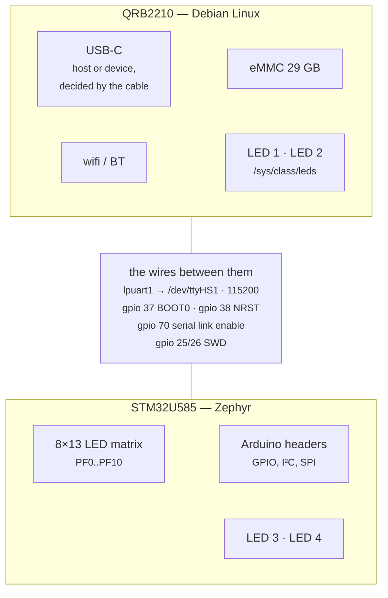

<!--
Copyright (c) 2026 Jim Wyatt
SPDX-License-Identifier: MIT
-->
# The hardware, honestly

The UNO Q is two computers sharing a board.

| | **MPU** (Linux side) | **MCU** (real-time side) |
|---|---|---|
| Part | Qualcomm QRB2210 (`arduino,imola`) | STM32U585 Cortex-M33 |
| Runs | Debian, Python, your services | Zephyr firmware |
| Memory | 3.6 GiB shared | 2 MB flash / 786 KB RAM (768 KB of it in Zephyr's memory map) |
| Reached via | native Linux syscalls | SWD, or a serial link |

Most Arduino-header GPIO is wired to the **MCU**, not the MPU. The MPU has its
own separate GPIO / I²C / SPI — that is what [`unoq`](mpu.md) talks to.



Every wire listed in the middle box is one this project drives, and getting any
of them wrong makes a working board look broken. They are the subject of the next
section.

---

> [!NOTE]
> Everything on this page was found by observing one running board. None of it
> has been confirmed by Arduino, Qualcomm or ST, and it may be different on
> another board revision or software image. Check it against your own board
> before you rely on it.

## The two GPIOs nobody documents

**Read this before debugging anything.** `arduino-router` used to drive two MPU
GPIO lines the MCU depends on. That service is now disabled, so these must be
set by us — and when they are wrong, a perfectly good board looks broken.

| `gpiochip1` line | Function | Symptom when wrong |
|---|---|---|
| **37** | MCU **BOOT0**, latched at reset | Firmware flashes *and verifies*, but never runs. PC sits around `0x0bf9xxxx` — the STM32 ROM bootloader. |
| **70** | **UART link enable** | MCU transmits fine (`LPUART1 CR1=0x2d`, TC/TXE set) but `/dev/ttyHS1` reads zero bytes. |
| 25 / 26 / 38 | SWD swdio / swclk / srst | — |

```bash
~/two-computers-one-board/mcu/link-up.sh      # BOOT0=0, link-enable=1
```

### They are documented, in the bootloader

"Nobody documents" was true of everything Arduino publishes and false of what
Arduino ships. U-Boot lives in the `boot_a` / `boot_b` partitions, and its
embedded devicetree names all five lines and sets their power-on state:

```bash
sudo dd if=/dev/disk/by-partlabel/boot_a bs=1M count=16 2>/dev/null \
  | strings -n 4 | grep -A2 -E '^mcu-.*-state$'
```

| Name in U-Boot's devicetree | GPIO | What this project calls it |
|---|---|---|
| `mcu-swdio-state` | 25 | SWD swdio |
| `mcu-swclk-state` | 26 | SWD swclk |
| `mcu-boot0-state` | 37 | BOOT0 |
| `mcu-nrst-state` | 38 | SWD srst |
| `mcu-spi-rdy-state` | 70 | UART link enable |

Two things follow. The states these lines are in before Linux starts are set by
U-Boot, not by anything on the rootfs — which is why they are sane at boot even
with `arduino-router` disabled.

And the last row disagrees with itself. Line 70 is empirically what makes
`/dev/ttyHS1` produce bytes, which is why this project calls it a UART enable.
U-Boot calls it an **SPI ready** line. Both descriptions can be true of one pin,
and the next section is the other half of that story.

### There is an SPI link between the two chips { #there-is-an-spi-link-between-the-two-chips-and-nothing-here-uses-it }

U-Boot's name for line 70 is not a mislabel. Linux's own devicetree describes
an SPI device called the MCU:

```bash
ls /sys/bus/spi/devices/                                   # spi0.0
cat /sys/bus/spi/devices/spi0.0/of_node/compatible; echo   # arduino,unoq-mcu
readlink -f /sys/bus/spi/devices/spi0.0/of_node
```

```
/sys/firmware/devicetree/base/soc@0/geniqup@4ac0000/spi@4a94000/mcu@0
```

| | |
|---|---|
| Controller | `spi@4a94000`, a Qualcomm GENI SPI master, `status = "okay"` |
| Device | `mcu@0`, chip select 0, `compatible = "arduino,unoq-mcu"` |
| Driver | `spidev` — no protocol driver, just raw access |
| Seen from Linux as | `/dev/spidev0.0`, group `spi` (your user is in it) |

So the port this project had been treating as a spare SPI bus is wired to the
microcontroller, and the other end has been found by experiment. Zephyr's board
definition enables `spi3` on four pins the Arduino header does not account for.
With those pins set as inputs from the MCU's shell, Linux sent long slow runs
over `/dev/spidev0.0` and the MCU reported what it saw; then the MCU drove its
output pin and Linux read.

| Signal | MCU pin | What was seen |
|---|---|---|
| Clock | PG9 | toggling during a transfer, low at rest |
| Chip select | PG12 | high at rest, low for the whole transfer |
| Linux to MCU (MOSI) | PB5 | follows the data: all ones, then all zeros |
| MCU to Linux (MISO) | PG10 | driven high, Linux reads `0xFF`; driven low, `0x00` |

So Linux is the master, the MCU is the slave on `spi3`, and all four lines work.

```bash
sudo systemctl stop unoq-cpu-bars       # the MCU's shell is needed
tio /dev/ttyHS1 -b 115200               # then, at its prompt:
#   gpio conf gpiog 9 i      (and gpiog 10, gpiog 12, gpiob 5)
#   gpio get gpiog 12        -> 1 at rest, 0 while Linux is transferring
```

What Arduino's own firmware sends over it is still not known, and neither is
line 70's "ready" role in a real exchange: this project uses the line only as
the serial link enable. The protocol below is this project's own.

**Do not use `/dev/spidev0.0` as if it were a free bus for your own
peripherals.** Whatever you clock out of it goes to the STM32, and with this
project's firmware the STM32 answers.

### The protocol on the SPI link

The firmware's
[`spi_link.c`](https://github.com/jim-wyatt/two-computers-one-board/blob/main/mcu/app/src/spi_link.c)
runs `spi3` as an SPI slave, and
[`unoq.spilink`](https://github.com/jim-wyatt/two-computers-one-board/blob/main/python/unoq/spilink.py)
is the master's side. The contract is
[`spi_proto.h`](https://github.com/jim-wyatt/two-computers-one-board/blob/main/mcu/app/include/spi_proto.h),
and `python/tests/test_spilink.py` checks that the two agree on every number.

| | |
|---|---|
| Wiring | `spi@4a94000` → `/dev/spidev0.0` on Linux, `spi3` on the MCU: SCK PG9, MISO PG10, MOSI PB5, NSS PG12 |
| Roles | Linux is the master; the MCU is a slave, interrupt-driven |
| Mode | SPI mode 0, 8 bits, MSB first, chip select active low for the whole transaction |
| Transaction | exactly 1024 bytes, both ways at once |
| Frame | magic `U` `Q`, type, seq, length (16-bit), payload, CRC-16/CCITT-FALSE; the rest of the transaction is padding |
| Services | `NOP`, `ECHO`, `TEMPLOG since` (the temperature log), `STAT` (the link's own counters), `SCOPE id offset` (the samples of [the scope](mcu.md#the-scope)'s last capture) |

The slave cannot speak first, so each request is answered **one transaction
later**: while Linux clocks request *k* down, the MCU's answer to *k − 1* comes
up. A single request costs two transactions, the request and a `NOP` that
collects its answer; the seq in each answer says which request it belongs to.
A benchmark pipelines instead, and every transaction carries data both ways.

Two things follow from the slave side of Zephyr's STM32 driver, and they are
why the protocol looks the way it does:

- **The transaction length is fixed.** The driver ends a slave transfer when
  its buffers are full, not when chip select rises, so a master that clocked a
  different length would leave the MCU counting bytes across transactions.
  `unoq.spilink` pads every frame to 1024 bytes; anything else talking to
  `/dev/spidev0.0` must do the same.
- **The MCU needs a moment between transactions** to decode a request and build
  the next answer. A transaction that starts sooner is missed: it reads back as
  no frame, the MCU keeps its pending answer, and `unoq.spilink` polls again.
  By default it waits 0.5 ms before each transaction (`--gap-us`).

Try it, with this project's firmware flashed:

```bash
hpy -m unoq.spilink echo hello
hpy -m unoq.spilink stat
hpy -m unoq.spilink bench        # bytes per second at 0.5 to 16 MHz
```

Measured on this board on 2026-10-31, firmware from main after #183, with the
CPU-bars demo stopped:

| clock | transactions | good | bad | KB/s each way | vs the UART |
|---|---|---|---|---|---|
| 500 kHz | 114 | 113 | 0 | 56.9 | 4.9x |
| 1 MHz | 212 | 211 | 0 | 106.7 | 9.3x |
| 2 MHz | 375 | 374 | 0 | 189.8 | 16.5x |
| 4 MHz | 618 | 0 | 617 | 0 | — |
| 8 MHz | 902 | 0 | 901 | 0 | — |
| 16 MHz | 1191 | 0 | 1190 | 0 | — |

The UART, for comparison, is 115200 baud: 11.5 KB/s, one way at a time.

**2 MHz is the ceiling, and it is a sharp one.** Every transaction at 2 MHz
was good, and none at 4 MHz. One interrupt per byte is what caps it: past that
rate the MCU cannot keep its FIFO fed. The link recovers at once. An `echo`
straight after the 16 MHz run came back intact; the link's own `stat` then
counted 2741 `spi_errors` from the fast rates and no bad frames. DMA would
lift the cap. The scope ([#159](https://github.com/jim-wyatt/two-computers-one-board/issues/159))
is the first part of the firmware to use the GPDMA, for its DAC and ADC; the
link itself still moves its bytes by interrupt.

`TEMPLOG` over SPI returns the same samples as `app temp log` on the shell:
`main.c` hands the link its log through the `spi_link_templog()` hook in
`spi_proto.h`.

### `link-up.sh` is run for you

Back to the two GPIO lines, BOOT0 and the link enable, and the script that sets
them. You rarely need to run
[`mcu/link-up.sh`](https://github.com/jim-wyatt/two-computers-one-board/blob/main/mcu/link-up.sh)
yourself: `mcu/flash.sh` runs it before every flash, `unoq.MCU` runs it on
construction, and `unoq-link.service` runs it at boot. All it does is drive
those two lines. None of that configures the SPI link described above.

Pin state **persists after the `gpioset` process exits** — the SoC pinctrl keeps
driving the last value — which is why a one-shot is enough and no daemon is
needed. BOOT0 is only sampled at MCU reset, so set it *before* resetting.

> ### Never `gpioget` these two lines
>
> `gpioget` **requests the line as an input**, and that drops the drive the same
> way a reboot without `unoq-link.service` would. Reading the pins is enough to
> break the link — you get plausible-looking values back (`37=active`,
> `70=inactive`, i.e. exactly the broken state) and the MCU goes quiet.
>
> Check them without touching them. `gpioinfo` only reads line *info*, never
> requests the line:
>
> ```bash
> gpioinfo -c gpiochip1 37 70      # both must say `output`
> hpy -c "from unoq.link import link_state; print(link_state())"
> ```
>
> `output` means driven. `input` means floating — run `link-up.sh`. This is why
> `unoq.link.link_state()` reports *direction* rather than value: there is no way
> to read the value that does not also destroy it.

> `/etc/systemd/system/unoq-link.service` runs root's copy of `mcu/link-up.sh`,
> at `/usr/local/lib/unoq/mcu/link-up.sh`. **Do not move or rename the script**
> without re-running `provision/45-mcu-link.sh`, which makes the copy and
> installs the unit. An edit to it reaches the board the same way.

### The I2C buses

Three appear on the Linux side. What is registered on each, read from sysfs
without probing anything:

| Bus | What is on it | Use it? |
|---|---|---|
| `/dev/i2c-0` | nothing registered | Yes: this is the free one |
| `/dev/i2c-1` | the display bridge (`anx7625` at `0x58`, and its other addresses) | No: it belongs to the bridge |
| `/dev/i2c-2` | that bridge's AUX channel | No |

Which connector bus 0 reaches has not been traced on the board. `i2cdetect`
was deliberately not run to find out: probing writes to the bus.

So of the "spare" buses provisioning opens up to your user, one I2C bus is
genuinely spare, and the SPI device is not: it is the link described above.

---

## The MCU's two UARTs

The STM32 has two serial ports, and they are **not** interchangeable. The Linux
side has a third of its own — see
[the next section](#the-third-uart-the-mpus-own-console).

| Node | Pins | Goes to |
|---|---|---|
| `lpuart1` | PG7/PG8 + RTS/CTS on PG6/PG5 | **the Linux MPU** → `/dev/ttyHS1` |
| `usart1` | PB6/PB7 | the Arduino header pins (D0/D1) |

Upstream Zephyr's `arduino_uno_q` board defaults `zephyr,console` to **`usart1`**,
so a stock `hello_world` prints to the *header pins* and you see nothing from
Linux. Override it in a board overlay — see
[`mcu/app/boards/arduino_uno_q.overlay`](../../mcu/app/boards/arduino_uno_q.overlay).

The RTS/CTS pair on `lpuart1` is the giveaway: hardware flow control means a
board-to-board link.

## The third UART: the MPU's own console

`/dev/ttyMSM0` is a serial port on the **Linux** side, and it has nothing to do
with the MCU. It is the kernel console.

| | |
|---|---|
| Hardware | Qualcomm GENI serial at `4a90000.serial` — a *different* port from `/dev/ttyHS1` (`4a88000.serial`) |
| Role | The kernel console: `/sys/class/tty/console/active` reads `tty0 ttyMSM0` |
| Selected by | Devicetree, not the kernel command line — `chosen/stdout-path = serial0:115200n8`, and there is no `console=` in `/proc/cmdline` |
| Held by | `serial-getty@ttyMSM0.service` → `agetty`, offering a login prompt |

```bash
cat /sys/class/tty/console/active        # tty0 ttyMSM0
cat /proc/cmdline                        # no console= in it
systemctl status serial-getty@ttyMSM0
```

The two Linux serial ports have unrelated names because of Qualcomm's history.
**MSM** is *Mobile Station Modem*. The GENI serial driver registers plain PIO
ports as `ttyMSM*` and DMA-capable high-speed ports as `ttyHS*` — the same
peripheral block in two flavors.

### It is the last recovery path

If the USB gadget will not bind, wifi is off, and no network reaches the board,
this port still gives a root login. It also carries kernel messages from the
first boot line onwards, before any network exists.

That is exactly the failure `usb/bind-guard.sh` and `net/uplink-fallback.sh`
are written for. This port is the escape hatch underneath both.

### It is a login for anyone who can touch the board

Anyone with a UART adapter and the right pads gets a password prompt. That is
normal for a development board, and worth knowing about one that sits on a
desk. If you do not want it:

```bash
sudo systemctl disable --now serial-getty@ttyMSM0
```

Doing so also removes the recovery login described above.

### Where it comes out is not verified

**Which physical pads this port lands on is not visible from software** and
needs the schematic. Everything else in this section was confirmed on the
running board; the pinout was not. There is deliberately no pin table here.

---

## The LED matrix

104 blue LEDs in an 8×13 grid, wired to the **MCU** on **PF0–PF10** and
charlieplexed: each LED is one *ordered* pair of those eleven pins, lit by
driving one high, one low, and leaving the other nine as inputs. Eleven pins
give 110 ordered pairs; the panel uses the first 104, in that order.

Upstream Zephyr's `arduino_uno_q` board **does not mention the matrix at all**,
and neither does the datasheet. The wiring is recorded in exactly one place —
Arduino's own core (`ArduinoCore-zephyr`, `loader/matrix.inc`) — which is where
this project's pin map and 10 µs refresh slot come from. Nothing else from that
core is used; the driver is
[`mcu/app/src/matrix.c`](../../mcu/app/src/matrix.c) and the devicetree nodes it
needs (`gpiof`, `timers17`) are declared in the app's board overlay.

PF11–PF15 are *not* part of the panel — PF14/PF15 reach the Arduino header — so
the driver masks only the low eleven pins when it tri-states the port.

See [mpu.md](mpu.md#cpu-bars-on-the-led-matrix) for the display built on this.

## The four RGB LEDs

Separate from the 8x13 matrix, and split across both processors. This trips
people up, because only half of them are visible from Linux.

| | Driven by | Named |
|---|---|---|
| **LED 1** | Linux | `unoq:user-red1` / `-green1` / `-blue1` |
| **LED 2** | Linux | `unoq:panic-red2` / `unoq:wlan-green2` / `unoq:bt-blue2` |
| **LED 3** | **STM32** | `led3_red` / `led3_green` / `led3_blue` |
| **LED 4** | **STM32** | `led4_red` / `led4_green` / `led4_blue` |

They sit in a row at the end of the board opposite the USB-C port, where the long
header ends. From the board's edge inwards they are LED 4, LED 3, LED 2 and
LED 1. So the two nearest the edge are the
microcontroller's, and the two further in are Linux's.

### Six sysfs entries are two LEDs

`/sys/class/leds/unoq:*` lists six writable channels, and it is very natural to
read that as six indicators. It is not: they are the red, green and blue
channels of two RGB packages, and the `-1` / `-2` suffixes are the only hint.

**sysfs cannot tell you this.** Every channel gets its own directory and its own
`brightness` file whether it is one package or six, and they all hang off the
same `gpio-leds` platform node. Lighting four channels to mean four separate
things produces two cyan LEDs, which is how this was discovered.

### `mmc0::` is not one of them

There is a seventh entry, `mmc0::`, and it is a different animal:

```
unoq:user-red1  ->  platform/leds/leds/...            (gpio-leds)
mmc0::          ->  platform/soc@0/4744000.mmc/leds/  (the MMC controller)
```

The MMC subsystem registers it so a board *can* wire an activity light to it.
Nothing is wired to it here. It has `max_brightness 255` where the real ones
have 1, and it will never light.

### The disk-activity triggers do not fire

`mmc0`, `disk-activity` and `disk-write` are all offered in every LED's trigger
list, and all of them accept being selected. **None of them do anything.**
Measured with 400 MB of `O_DIRECT` writes in flight, sampling brightness 400
times: on in **zero** samples, for all three.

Being listed is not being implemented. If you want disk activity on a LED here,
you must sample `/sys/block/mmcblk0/stat` yourself - that counter does move.

### What this project shows on them

`status/leds.sh` (Linux) and `mcu/app/src/status_leds.c` (firmware):

| | LED 1 | LED 2 | LED 3 | LED 4 |
|---|---|---|---|---|
| **steady** — fine | green: internet reachable | green: all units healthy | green: image **confirmed** | green: MPU spoke recently |
| **slow blink**, once every 2 s — degraded, or in progress | blue: cable, but no route beyond | yellow: kernel **on trial**, not marked good yet<br>blue: a kernel was **set aside** after using its tries | yellow: image **unconfirmed**, reverts on reset | — |
| **fast blink**, twice a second — needs a human | red: no uplink at all | red: unit failed / bind guard tripped | red: subsystem failed | red: MPU silent >4s |
| **dark** — nothing is driving it | `unoq-leds` is not running | `unoq-leds` is not running | the firmware is not running | the firmware is not running |

Read it by row. The rhythm identifies the kind of state by itself, so none of
this depends on telling red from green. The color is a second witness, not the
only one. Both blinks are lit half the time.

LED 2 is the one LED with two states in a row, both from boot counting
([troubleshooting.md](troubleshooting.md#a-new-kernel-that-did-not-come-up)).
The rhythm says "degraded, or in progress" either way, and the color says
which, as yellow against blue: the pair red-green color blindness leaves
apart. Yellow is LED 3's yellow, for the same idea on the other chip. On trial
comes from `systemd-bless-boot status` saying `indeterminate`, asked every
pass. Set aside comes from `bootctl list` showing an entry with no tries left
that is not the one booted, asked every minute. A failed unit outranks both,
and set aside outranks on trial. A board without boot counting never shows
either.

LED 1 and LED 2 are blinked by the kernel's `timer` LED trigger, which
`leds.sh` selects and then leaves alone until the state changes: every write to
`delay_on` or `delay_off` restarts the blink, so rewriting an unchanged state
would make it stutter. LED 3 and LED 4 are redrawn by the firmware every
250 ms from one counter, so the red and green channels of yellow cannot fall
out of step. If a kernel offers no `timer` trigger, `leds.sh` shows the color
steady and says so once in its log.

LED 4 is worth understanding: it shows the *absence* of traffic. A blink per
message would be a clock - `cpubars` sends twice a second, so it would blink
twice a second forever and mean nothing. The tick stopping is the news, and it
is news Linux cannot deliver, because a host that has stopped talking cannot
report that it stopped.

`~/two-computers-one-board/status/leds.sh explain` prints the current scheme; `... test` cycles the
states so you can learn which physical LED is which, and
`... show 1 blue slow` puts one LED into one color and rhythm by hand (stop
`unoq-leds` first, or its next pass puts the truth back).

## The Qualcomm boot chain: look, do not touch

Everything below U-Boot is Qualcomm's: signed, undocumented, and stored as a
pair of partitions per stage. This section is what one board showed when it was
looked at, read-only, on 2026-10-31, and it is here for one reason: so that
nothing this project installs ever writes there. It is layer 4 of
[issue #93](https://github.com/jim-wyatt/two-computers-one-board/issues/93),
"a recovery path no matter what", and the layer whose whole plan is to leave it
alone. [From power to prompt](../learn/from-power-to-prompt.md) explains what
each stage does; this is the detail behind it.

### The slots

`lsblk -o NAME,SIZE,PARTLABEL` lists 69 partitions on the eMMC, and
`/dev/disk/by-partlabel/` names every one. Most of the boot chain comes in pairs:

| Pair | Size | What it is | `_a` and `_b` |
|---|---|---|---|
| `xbl`, `xbl_config` | 3.5M, 128K | the first stage after the ROM; trains the RAM | identical |
| `tz`, `hyp`, `rpm` | 4M, 512K, 512K | the secure world, the hypervisor, the power processor | identical |
| `abl` | 1M | Qualcomm's Android-style loader | identical |
| `boot` | 4M | **U-Boot**, which presents UEFI and starts systemd-boot | identical |
| `uefi`, `uefi_dtb` | 8M, 1M | | both slots empty (all zeros) |
| `ddr` | 1M | | `_a` holds data, `_b` is empty |
| `devcfg`, `qupfw`, `keymaster`, `imagefv`, `uefisecapp`, `featenabler`, `mdtp`, `mdtpsecapp`, `multiimgoem` | small | configuration and secure applications | pairs |

"Identical" is `sha256sum` of each pair, read as root; nothing was written.
The two copies of every stage that holds code are byte-for-byte the same, so
`_b` is a real second copy, not an empty placeholder. `ddr_a` is the one that
differs, which fits RAM training results being saved there on first boot, but
that is a guess. The empty `uefi` pair fits UEFI coming from U-Boot in `boot`
instead.

After those come the partitions this project does use: `efi` (`mmcblk0p67`,
512 MB vfat, the ESP), `rootfs` (`p68`) and `userdata` (`p69`, mounted as
`/home/arduino`).

### Which slot is active, and how it is marked good

The stock image ships `qbootctl`, "a utility to control Qualcomm A/B boot
slots", and a unit that runs it on every boot:

```ini
# systemctl cat qbootctl.service (comments left out)
[Unit]
Description=Mark the Current Boot slot as Good
DefaultDependencies=no
Requires=boot-complete.target
After=local-fs.target boot-complete.target
[Service]
Type=oneshot
ExecStart=/usr/bin/qbootctl -m
[Install]
WantedBy=multi-user.target
```

`-m` marks the current slot's boot successful. The unit's header says it was
copied from `systemd-bless-boot.service`, and it works the same way: it waits
for `boot-complete.target`, and on this image nothing else does, so the target
is reached as soon as `sysinit.target` is and the slot is marked good in the
first seconds of every boot.

`qbootctl` with no arguments dumps the slots, and `-a`, `-c`, `-b SLOT`,
`-n SLOT` and `-x` only ask questions. Those are the only modes run here
(`sudo qbootctl`):

```
Couldn't find cmdline arg: 'slot_suffix'
get_current_or_active_slot: Unable to read boot slot property
Current slot: _a
SLOT _a:
	Active      : 1
	Successful  : 1
	Bootable    : 1
SLOT _b:
	Active      : 0
	Successful  : 0
	Bootable    : 1
```

The first two lines matter. On an Android phone the boot loader tells the
kernel which slot it chose (`androidboot.slot_suffix` on the command line).
Here the command line comes from systemd-boot and does not say, so `qbootctl`
works it out from the partition table instead: the slot flags are bits in each
partition's GPT attributes. `sfdisk --part-attrs /dev/mmcblk0 N` reads them
without changing anything:

| Partition | Attribute bits |
|---|---|
| `boot_a` (`p11`) | 48, 49, 50, 52, 53, 54, 60 |
| `boot_b` (`p12`) | 60 |
| `xbl_a`, `uefi_a` | 50, 60 |
| `abl_a` | 50, 54, 60 |
| every `_b` | 60 |

Qualcomm's open boot loader source names these bits: 48–49 priority, 50
active, 51–53 retry count, 54 successful, 55 unbootable. Read that way,
`boot_a` is active, top priority and successful, which is exactly what
`qbootctl` reports. Bit 60 is on everything and is not explained. **Which
stage reads these bits at power-on, and how many failed boots switch it to
`_b`, could not be observed from Linux** and is not documented by Arduino.
The usual Qualcomm design is that the early boot loaders do, and that a slot
which keeps failing without being marked successful is given up on.

The modes that change things, `-s SLOT` (set active), `-m` (mark successful)
and `-u` (mark unbootable), were not run, and nothing in this project runs
them.

### How that relates to boot counting

There are two separate "this boot was good" marks on this board, at two
layers, and they must not be confused:

| | Firmware slot | Kernel entry |
|---|---|---|
| What is on trial | `boot_a` or `boot_b` (U-Boot and everything under it) | a systemd-boot entry on the ESP |
| Marked by | `qbootctl -m`, from `qbootctl.service` | `systemd-bless-boot`, from boot counting |
| Waits for | `boot-complete.target` (stock) | `unoq-boot-health.service` (this project) |
| Written where | GPT attributes on the eMMC | a file name on the ESP |
| Owned by | Arduino's image | this project, with `--with-boot-counting` |

`unoq-boot-health.service` deliberately orders itself before
`systemd-bless-boot.service`, not before `boot-complete.target` where
systemd's documentation would put it. Ordered before the target, a boot
without SSH would have held up `qbootctl -m` as well, and enough boots left
unmarked could make the Qualcomm chain give up on `_a`, for a kernel problem
that slot has nothing to do with. The first version did that; it was caught on
the board before any reboot. [Provisioning](provisioning.md) and
`provision/82-boot-counting.sh` explain the rest.

### Linux cannot write EFI variables here

`efivarfs` is mounted read-only (`mount` shows
`efivarfs on /sys/firmware/efi/efivars type efivarfs (ro,...)`), and
`bootctl status` says "No boot loaders listed in EFI Variables". U-Boot exposes
the variables systemd-boot sets at boot for reading, but offers no store Linux
can write at run time, so `bootctl set-default` and `set-oneshot` fail with
"Read-only file system". Everything that decides what boots next lives in
files on the ESP: `loader/loader.conf` and the entries' names and sort order.
There is a 512K `uefivarstore` partition; whether U-Boot uses it was not
checked.

### What this project writes, and what it never writes

**Writes:** files on the ESP, through the mounted filesystem at `/boot/efi`.
That is systemd-boot's entries under `loader/entries/`, renamed by boot
counting, and nothing else. `loader.conf` and the default entry are left as
the image has them, and `85-esp-permissions.sh` makes the ESP root-only.

**Never writes:** any `_a`/`_b` firmware partition, the slot attributes in the
partition table, or the partition table itself. No `qbootctl -s`, `-m` or
`-u`, no `dd` onto `/dev/mmcblk0*` or `/dev/disk/by-partlabel/*`, and
`qbootctl.service` is never stopped or disabled
(`provision/10-optimize-board.sh` lists it as do-not-touch).
[`tests/no-slot-writes.bats`](../../tests/no-slot-writes.bats) greps every
tracked file for those writes on every CI run, and plants one of each in a
scratch repository to prove it would notice.

The reason is that this layer is the floor under every other way back. A bad
kernel falls back to the previous entry; a bad entry can be fixed from a rescue
system; a bad write to `xbl` or `boot` is a board that never reaches U-Boot,
and the only way back is the factory flasher.

### What the factory flasher restores

Arduino's [`arduino-flasher-cli`](https://github.com/arduino/arduino-flasher-cli)
(`flash unoq`) talks to the board in Qualcomm's emergency download mode (EDL,
USB ID `05c6:9008`; Arduino's
[update guide](https://docs.arduino.cc/tutorials/uno-q/update-image/) has the
jumper that gets it there) and runs an embedded copy of `qdl` with the image's
`prog_firehose_ddr.elf`, `rawprogram0.xml` and `patch0.xml`, on `--storage
emmc`. That reflashes the eMMC from the image's own partition table
(`gpt_main0.bin`), from below anything on the board, so it needs neither
U-Boot, Linux nor either slot to work.

From the flasher's source (October 2026):

- `--preserve-user` uses the image's `rawprogram0.nouser.xml` instead, which
  leaves `userdata` (`/home/arduino`) alone when the board's partition table
  allows it.
- `--root-size` (for example `--root-size 12GB`; the source sets a floor of
  9 GiB) rewrites the partition table with a different `rootfs` size and moves
  `userdata` after it.

**Not confirmed:** exactly which partitions `rawprogram0.xml` writes (whether
both `_a` and `_b` of every pair, and whether `persist`, `modemst*` and the
other calibration partitions are included), and whether the rewritten
partition table resets the slot attributes to `_a`. Both need a copy of the
image's `flash/` directory, which was not downloaded for this. Arduino does not
document either.

---

## How the MPU flashes the MCU

There is no external debug probe. The MPU bit-bangs SWD on its own GPIO lines
using OpenOCD's `linuxgpiod` driver:

```
Info : Linux GPIOD JTAG/SWD bitbang driver (libgpiod v2)
Info : SWD DPIDR 0x0be12477
Info : [stm32u5.cpu] Cortex-M33 r0p4 processor detected
```

No root needed — your user is in the `gpiod` group.

> **`/opt/openocd` is owned by no Debian package.** `dpkg -S /opt/openocd` finds
> nothing; it was placed there by an install script, so apt will never reinstall
> it. Copy it somewhere safe (`cp -a /opt/openocd ~/uno-q-backup/`) before you
> purge anything, and note that it is reproducible from source — see
> [Working on this project](development.md#rebuilding-openocd).

`apt install openocd` does **not** substitute: Debian ships 0.12.0 (2023), which
predates the libgpiod v2 support this board needs.

---

## Flash layout

```
0x08000000  boot_partition   64K   MCUboot (38K used)
0x08010000  slot0           416K   running signed app
0x08078000  slot1           416K   staged update
0x080e0000  storage         128K   NVS (settings: panel orientation)
```

Two 416K slots out of 2 MB of flash, which is why
[the MCU is 96% empty](https://github.com/jim-wyatt/two-computers-one-board/issues/12) is
an open question rather than a boast — the part has two banks and this layout
uses one.

Images link at `0x08010000` and must be **signed** — MCUboot refuses a raw
image. See [mcu.md](mcu.md).
